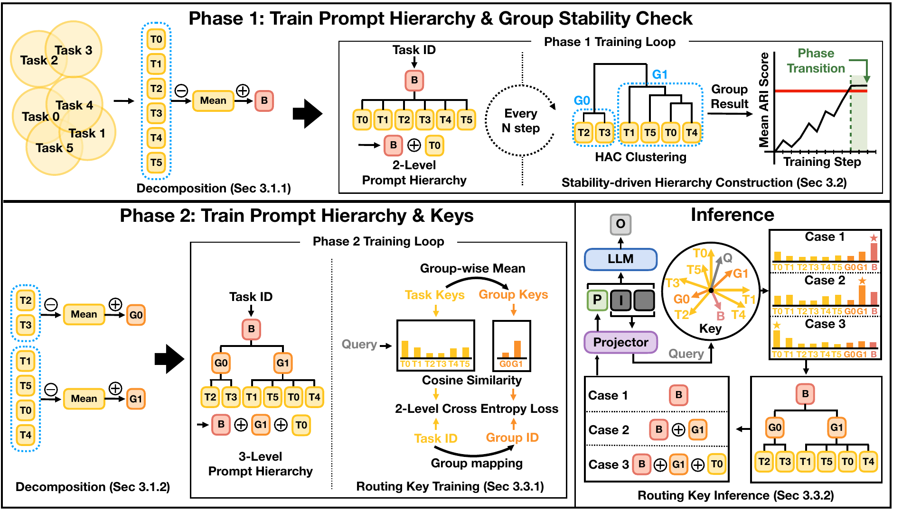

# HiVe: Beyond Static Prompts for Multitask Learning via Hierarchy-based Vertical Mixture-of-Experts

[](https://arxiv.org/pdf/2608.29790)

Official implementation of **HiVe**, a prompt tuning framework that models prompts at multiple levels and enables input-dependent specialization via a vertical mixture-of-experts (V-MoE) routing mechanism.

---

## TL;DR

HiVe addresses the *flat prompt space* limitation of existing prompt-tuning / MoE approaches, where all prompts are treated as experts at the same level of specialization. HiVe introduces three key ideas:

- **Emergent prompt hierarchy** — a data-driven base/group/task prompt hierarchy is induced through stability-aware clustering of learned task relationships.
- **Residual prompt decomposition** — shared information is pushed to higher-level prompts while task-specific information is preserved at lower levels, reducing intra- and inter-level redundancy and interference.
- **Vertical MoE routing** — a key-based hierarchical routing mechanism dynamically determines how deeply to traverse the prompt hierarchy for each input, composing prompts down to the selected level.

---

## Method Overview

HiVe trains in two phases and then performs input-adaptive inference:

1. **Phase 1 — Prompt hierarchy & group stability check**: learn a two-level (base + task) prompt hierarchy, periodically cluster task prompts (HAC) and monitor the mean ARI to detect a stable grouping.
2. **Phase 2 — Hierarchy & routing keys**: once grouping stabilizes, decompose into the full three-level (base/group/task) hierarchy and jointly train routing keys with a two-level cross-entropy loss (task ID + group ID).
3. **Inference — V-MoE routing**: match each input query against the learned routing keys to select the appropriate specialization level, then compose the final prompt along the corresponding hierarchical path (base only / base+group / base+group+task).

<p align="center">
  
</p>

---

## Requirements

```bash
pip install -r requirements.txt
```

**Environment**
- Python 3.10.19
- PyTorch 2.9.1+cu130
- CUDA 13.0

---

## Datasets

HiVe is evaluated on:
- **MRQA** — 12 machine reading QA datasets (in-domain / out-of-domain splits)
- **Summarization** — 11 summarization datasets (in-domain / out-of-domain splits)

---

## Quick Start

### MRQA

```bash
bash scripts/run_mrqa.sh
```

### Summarization

```bash
bash scripts/run_summary.sh
```

Each script runs training followed by out-of-domain evaluation and saves all results under the output directory.

---

## Expected Results

| Dataset     | Metric  | In-Domain | Out-of-Domain |
|-------------|---------|-----------|---------------|
| MRQA        | F1      | 75.4      | 62.8          |
| Summary     | ROUGE-L | 26.1      | 16.8          |

Values are HiVe's average scores across datasets, as reported in the paper (Tables 1–2).

---

## Project Structure

```
HiVe/
├── train.py              # Training entry point (task embedding, soft prompt init, optimizer setup)
├── evaluate.py           # Out-of-domain evaluation (checkpoint loading, test set inference)
├── engine.py             # Train loop (Phase 1/2 transition, HAC clustering, ARI stability check)
├── dataset.py            # MRQADataset, SummarizationDataset, collate_fn
├── scripts/
│   ├── run_mrqa.sh       # MRQA reproduction script (train + evaluate)
│   └── run_summary.sh    # Summary reproduction script (train + evaluate)
├── models/
│   ├── __init__.py
│   ├── model.py          # SoftPromptModel (frozen LLM wrapper, prompt prepending)
│   └── prompt.py         # HiVePrompt (hierarchical residual soft prompt, router)
└── utils/
    ├── __init__.py
    ├── config.py         # SoftPromptConfig (training/evaluation hyperparameters)
    └── metrics.py        # F1, EM (MRQA), ROUGE-L (Summary)
```

---

## Citation

```bibtex
@inproceedings{bae2026hive,
  title     = {HiVe: Beyond Static Prompts for Multitask Learning via Hierarchy-based Vertical Mixture-of-Experts},
  author    = {Bae, Hyeonjik and Kim, Minyeol and Yoon, Susik},
  booktitle = {Proceedings of the 2026 Conference on Empirical Methods in Natural Language Processing (EMNLP)},
  year      = {2026}
}
```
